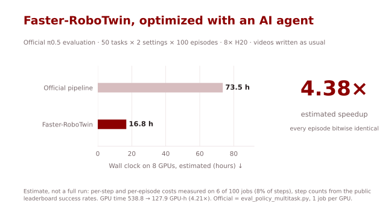
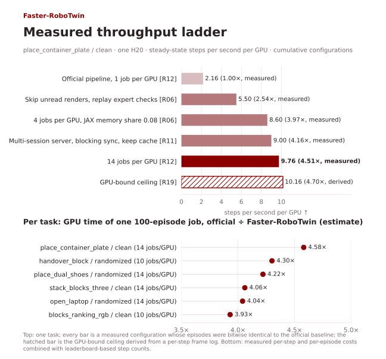
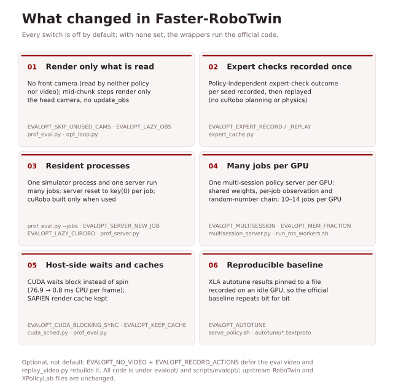
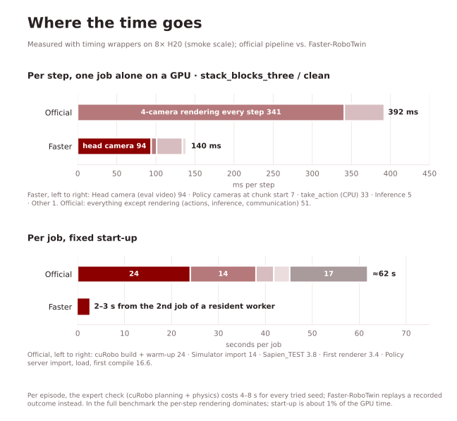
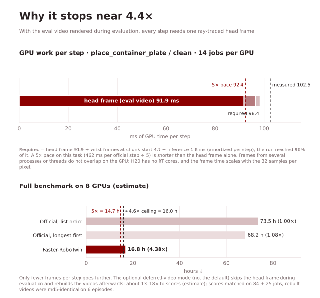

# Faster-RoboTwin

[English](README.md) | [简体中文](README.zh-CN.md)

**AI agent 优化的 RoboTwin 2.0 官方 π0.5 评测：在 8 张 H20 上跑完整套评测，估计约快 4.4 倍，比对过的每个回合都与官方流程逐位相同。**



| 流程 | 8 张 H20 墙钟时间（估计）↓ | GPU 时间（估计）↓ | 加速比 ↑ |
|---|---:|---:|---:|
| 官方（`eval_policy_multitask.py`，每卡 1 个作业） | 73.5 小时 | 538.8 GPU·小时 | 1.00× |
| **Faster-RoboTwin** | **16.8 小时** | **127.9 GPU·小时** | **4.38×**（GPU 时间 4.21×） |

评测对象是 RoboTwin 2.0 对官方 π0.5 co-train 权重（step 29999）的官方评测：50 个任务 × {clean, randomized} × 每个 100 个被接受的回合，开 expert check，原生 50 步动作块，10 步 flow 采样，每个回合输出评测视频。**上表是估计，不是一次实测跑完的结果。** [`evalopt/full_estimate.py`](evalopt/full_estimate.py) 用 100 个作业里 6 个的实测每步、每回合成本（覆盖 8% 的步数；官方成本来自 2–10 回合的运行，Faster-RoboTwin 为每卡 10–14 个作业），再按公开榜单的逐任务成功率推出步数（共 385 万步）。没测的作业取同一设置下已测作业的均值。Faster 一栏回放记录好的专家筛选结果（与 policy 无关，每个作业录一次）。两条流程都没有完整跑过全部 10,000 个回合。详见[测速与估计口径](docs/measurement.md)。

## 快速开始

按上游说明装好 RoboTwin、仿真环境和 Pi_05 策略环境（[环境与版本](docs/evaluation.md)），下载官方权重，然后：

```bash
git clone --recurse-submodules https://github.com/AI4AI-for-Anything/Faster-RoboTwin.git
cd Faster-RoboTwin
cp scripts/evalopt/activate-sim.example.sh scripts/evalopt/activate-sim.sh   # 修改：仿真环境 + Vulkan/EGL
export PI05_CKPT=/path/to/RoboTwin-lerobot_v30-aloha_agilex-joint-0/29999

source scripts/evalopt/configs/faster.env     # 实测用的开关
mkdir -p runs records
python evalopt/make_jobs.py runs/jobs_w1.json 19001 0 runs/gpu0/w1 \
  place_container_plate:demo_clean:100:record=records/place_container_plate_clean.pkl
bash scripts/evalopt/run_ms_workers.sh 0 19001 runs/gpu0 runs/jobs_w1.json   # 每个 worker 一个 jobs.json
```

`run_ms_workers.sh` 在每张卡上起一个多会话 policy 服务，每个 `jobs.json` 起一个常驻仿真 worker；实测用的是每卡 10–14 个 worker。一个作业第一次跑时记录专家筛选结果（`record=`），之后再跑（包括换别的权重）就回放（`replay=`）。实测环境为官方环境（仿真：Python 3.10、SAPIEN 3.0.0b1、cuRobo 0.7.8；策略：JAX 0.5.3），**8 张 H20**。不设置任何开关时，包装层直接调用官方代码。这里的脚本就是实测用的脚本，只是把工作区路径换成了变量（`scripts/evalopt/env.sh`）；改完之后做了语法检查，并对照钉死的上游提交做了静态核对，没有重新跑过。仓库里没有调度全部 100 个作业的调度器（全局最长先跑队列、错开启动、worker 超时、出错重跑），见[启动说明](docs/evaluation.md#launch)。

## Agent 优化过程

R00–R19 各轮于 2026-10-17/18 完成。上图每根柱子是一个配置在一个任务上的实测吞吐，其回合与官方参考逐位相同；下图是各任务 100 回合作业的估计加速比。



逐轮做法见[轮次记录](docs/rounds.md)。

## 主要改动

每个开关都是一个 `EVALOPT_*` 环境变量，默认关闭。上游 RoboTwin 和 XPolicyLab 的文件一个都没改：开关实现在 [`evalopt/`](evalopt) 下的包装层里，另有两个上游函数的最小差异拷贝（`opt_loop.py`、`opt_take_action.py`，各只有一处标注的改动）。

- **只渲染有人读的画面**：前视相机 policy 和视频都不读，不再渲染；动作块中间的步只为视频渲染头部相机，不发 `update_obs`。每个动作块开头 policy 照常拿到完整的头部和双腕观测。
- **专家筛选只录一次**：官方专家筛选在每个 seed 上的结果录一次、之后回放，省掉之后每次运行里的 cuRobo 规划和物理仿真，也让整任务可以逐位比对。
- **常驻进程**：一个仿真进程和一个 policy 服务连跑多个作业；每个作业开始时把服务重置到 `key(0)`，cuRobo 用到时才建。每个作业的固定开销从 45–60 秒降到 2–3 秒。
- **每卡多作业**：每张卡一个多会话 policy 服务（共用权重，每个作业有自己的观测和随机数链，JAX 显存份额 0.08），每卡 10–14 个常驻 worker。
- **CPU 侧等待与缓存**：等 GPU 时 CUDA 改为阻塞而不是自旋（每帧 CPU 76.9 → 0.8 毫秒）；不再每 5 回合清一次 SAPIEN 渲染缓存。
- **参考可复现**：XLA autotune 结果钉在一份空闲 GPU 上录的文件里，参考和优化版都用它。





见[开关表](docs/evaluation.md#switches)和[实测配置](scripts/evalopt/configs/faster.env)。

## 正确性验证

所有采纳的开关都是 **E0**：每个回合，优化版与官方参考在以下各项上逐位相同——seed、指令、是否成功、步数、policy 查询次数、policy 实际读到的每份观测的哈希、返回的每个动作块的哈希、写进评测视频的每一帧的哈希（[`compare_arms.py`](evalopt/compare_arms.py)）。参考就是官方函数加上计时和哈希包装；同一个 case 用完全不带包装的官方入口跑，评测视频 md5 也相同。

- 比对了 7 个任务（clean：adjust_bottle、blocks_ranking_rgb、place_container_plate、stack_blocks_three；randomized：handover_block、open_laptop、place_dual_shoes），包含跑满 800 步和 1200 步的失败回合。部署形态下（多会话服务、每卡 6–14 个作业）136 个作业逐位相同；另有 1 个作业在整机高负载时遇到渲染错误（官方循环会把它记成失败），按无效运行处理。
- 所有比对都是 smoke 规模（每个作业 2–10 回合）。最长的两个任务（step limit 1500–1700）没有比对，也没有端到端比对过 100 回合的作业。
- 官方流程本身就不能逐位复现，所以先处理了三个来源：XLA autotune 选法随负载变（钉到文件）、专家筛选在不同进程里对同一个 seed 时而接受时而拒绝（录一份、两臂回放同一份）、指令依赖 `--test_num`（小回合 smoke 不是正式评测的子集）。

见[验证方法](docs/validation.md)。

## 可选：推迟视频

不是默认配置，也不算进主结果。设 `EVALOPT_NO_VIDEO=1 EVALOPT_RECORD_ACTIONS=1` 后，评测时每一步都不渲染头部相机，并保存动作块；事后用 [`replay_video.py`](evalopt/replay_video.py) 补出视频。成绩和除视频外的所有指纹，在每卡 14 个作业的 84 个作业、每卡 1–12 个作业的 25 个作业上都与官方逐位相同；补出的 mp4 与官方 md5 相同，**只验证了 6 个回合**（2 个任务）。只算出成绩的时间估计约快 13–18 倍（8 卡 4.1–5.7 小时）。如果所有视频都要补，GPU 总量和评测时直接渲染差不多；这个模式改变的是视频什么时候生成，需要明确决定后再用（[详情](docs/evaluation.md#deferred-video-optional)）。

## 为什么停在约 4.4×

评测时照常写视频，每一步都要光追渲染一帧头部相机（每像素 32 采样，在没有 RT core 的 H20 上约 92 毫秒），而且不同进程、不同线程的帧在 GPU 上不会重叠。在 place_container_plate 上，最终配置已经用到每步 GPU 需求的 96%；在这个任务上要达到 5×，每一步得比单单这一帧头部画面还快。整套评测的上限估计约 4.6×。



见[为什么停在这里](docs/measurement.md#why-it-stopped-near-44)，以及试过但没有采纳的方向。

## AI4AI-for-Anything 的其他项目

[Faster-JiT](https://github.com/AI4AI-for-Anything/Faster-JiT) · [Faster-RAE](https://github.com/AI4AI-for-Anything/Faster-RAE) · [Faster-LLaVA](https://github.com/AI4AI-for-Anything/Faster-LLaVA) · [Faster-DMD](https://github.com/AI4AI-for-Anything/Faster-DMD) · [Faster-SelfForcing](https://github.com/AI4AI-for-Anything/Faster-SelfForcing)

## 上游 RoboTwin 文档

本项目基于 [RoboTwin-Platform/RoboTwin](https://github.com/RoboTwin-Platform/RoboTwin) `ea8b211`（XPolicyLab 子模块 `fa431ec`），作者为 RoboTwin 团队（Tianxing Chen、Yao Mu 等）。[论文](https://arxiv.org/abs/2506.18088) · [文档](https://robotwin-platform.github.io/doc/) · [榜单](https://robotwin-platform.github.io/leaderboard) · [MIT 许可证](LICENSE)。官方 π0.5 权重和仿真资产来自 [RoboTwin 2.0 数据集](https://huggingface.co/datasets/TianxingChen/RoboTwin2.0)。原始 README 保存在 [README.upstream.md](README.upstream.md)，并附在下方。

<details>
<summary>原始 RoboTwin README：安装、数据、使用与引用</summary>

<h1 align="center">
  <a href="https://robotwin-benchmark.github.io"><b>RoboTwin</b> Bimanual Robotic Manipulation Platform<br></a>
</h1>
<h2 align="center">Latest Version: RoboTwin 2.0<br>🤲 <a href="https://robotwin-platform.github.io/">Webpage</a> | <a href="https://robotwin-platform.github.io/doc/">Document</a> | <a href="https://arxiv.org/abs/2506.18088">Paper</a> | <a href="https://robotwin-platform.github.io/doc/community/index.html">Community</a> | <a href="https://robotwin-platform.github.io/leaderboard">Leaderboard</a></h2>

https://private-user-images.githubusercontent.com/88101805/463126988-e3ba1575-4411-4a36-ad65-f0b2f49890c3.mp4

**RoboTwin 2.0** (*ICML 2026*) — [Webpage](https://robotwin-platform.github.io/) · [Doc](https://robotwin-platform.github.io/doc) · [Paper](https://arxiv.org/abs/2506.18088) · [Talk](https://www.bilibili.com/video/BV18p3izYE63/?spm_id_from=333.337.search-card.all.click) · [机器之心](https://mp.weixin.qq.com/s/SwORezmol2Qd9YdrGYchEA) · [Leaderboard](https://robotwin-platform.github.io/leaderboard)

<details>
<summary>Earlier papers & challenge report</summary>

- **1.0 / Early** — RoboTwin: Dual-Arm Robot Benchmark with Generative Digital Twins · *CVPR 2025 (Highlight)* [PDF](https://arxiv.org/pdf/2504.13059) / [arXiv](https://arxiv.org/abs/2504.13059) · *ECCV Workshop 2024 (Best Paper)* [PDF](https://arxiv.org/pdf/2409.02920) / [arXiv](https://arxiv.org/abs/2409.02920)
- **CVPR'25 MEIS Challenge Report** — [PDF](https://arxiv.org/pdf/2506.23351) / [arXiv](https://arxiv.org/abs/2506.23351) · [量子位](https://mp.weixin.qq.com/s/qxqs9vvvHsAJ-0hoYANYzQ)

</details>

# 📚 Overview

> Prefer the [RoboTwin Document](https://robotwin-platform.github.io/doc/) for full guides — this README is a quick start.

RoboTwin 2.0 and [RoboDojo](https://github.com/RoboDojo-Benchmark/RoboDojo) share deployment via [XPolicyLab](https://github.com/XPolicyLab/XPolicyLab): one policy-serving / eval stack across both benchmarks (single-task, multi-GPU, and remote server + local sim).

**Default branch:** [`main`](https://github.com/RoboTwin-Platform/RoboTwin/tree/main) (RoboTwin 2.0).

<details>
<summary>Other branches (legacy / special-purpose)</summary>

- [IsaacLab-Arena](https://github.com/RoboTwin-Platform/RoboTwin/tree/IsaacLab-Arena) · [RLinf_support](https://github.com/RoboTwin-Platform/RoboTwin/tree/RLinf_support) · [WBCD-2026](https://github.com/RoboTwin-Platform/RoboTwin/tree/WBCD-2026)
- [RoboTwin-1.0](https://github.com/RoboTwin-Platform/RoboTwin/tree/RoboTwin-1.0) / [early_version](https://github.com/RoboTwin-Platform/RoboTwin/tree/early_version) · [gpt](https://github.com/RoboTwin-Platform/RoboTwin/tree/gpt)
- [Challenge-Cup-2025](https://github.com/RoboTwin-Platform/RoboTwin/tree/Challenge-Cup-2025) · [CVPR-Challenge-2025-Round1](https://github.com/RoboTwin-Platform/RoboTwin/tree/CVPR-Challenge-2025-Round1) / [Round2](https://github.com/RoboTwin-Platform/RoboTwin/tree/CVPR-Challenge-2025-Round2)

</details>

# 🐣 Update
* **2026/08/03**, We add [XPolicyLab](https://github.com/XPolicyLab/XPolicyLab)-based policy evaluation with single-task evaluation, multi-task multi-GPU scheduling, and remote policy-server/local-simulator deployment.
* **2026/03/03**, We release [RMBench](https://github.com/RoboTwin-Platform/RMBench), which is a memory-dependent manipulation benchmark built upon RoboTwin 2.0.
* **2026/02/20**, Usage supported in <a href="https://github.com/starVLA/starVLA">StarVLA</a>, which is a user-friendly codebase for VLA development.
* **2026/01/23**, We update IsaacLab-Arena and <a href="https://github.com/RLinf/RLinf">RLinf</a> support (contributed by RLinf team).
* **2025/08/28**, We update the RoboTwin 2.0 Paper [PDF](https://arxiv.org/pdf/2506.18088).
* **2025/08/25**, We fix ACT deployment code and update the [leaderboard](https://robotwin-platform.github.io/leaderboard).
* **2025/08/06**, We release RoboTwin 2.0 Leaderboard: [leaderboard website](https://robotwin-platform.github.io/leaderboard).
* **2025/07/23**, RoboTwin 2.0 received Outstanding Poster at ChinaSI 2025 (Ranking 1st).
* **2025/07/19**, We Fix DP3 evaluation code error. We will update RoboTwin 2.0 paper next week.
* **2025/07/09**, We update endpose control mode, please see [[RoboTwin Doc - Usage - Control Robot](https://robotwin-platform.github.io/doc/usage/control-robot.html)] for more details.
* **2025/07/08**, We upload [Challenge-Cup-2025](https://github.com/RoboTwin-Platform/RoboTwin/tree/Challenge-Cup-2025) Branch (第十九届挑战杯分支).
* **2025/07/02**, Fix Piper Wrist Bug [[issue](https://github.com/RoboTwin-Platform/RoboTwin/issues/104)]. Please redownload the embodiment asset.
* **2025/07/01**, We release Technical Report of RoboTwin Dual-Arm Collaboration Challenge @ CVPR 2025 MEIS Workshop [[arXiv](https://arxiv.org/abs/2506.23351)] !
* **2025/06/21**, We release RoboTwin 2.0 [[Webpage](https://robotwin-platform.github.io/)] !
* **2025/04/11**, RoboTwin is selected as <i>CVPR Highlight paper</i>!
* **2025/02/27**, RoboTwin is accepted to <i>CVPR 2025</i> ! 
* **2024/09/30**, RoboTwin (Early Version) received <i>the Best Paper Award  at the ECCV Workshop</i>!
* **2024/09/20**, Officially released RoboTwin.

# 🛠️ Installation

See [RoboTwin 2.0 Document (Usage - Install & Download)](https://robotwin-platform.github.io/doc/usage/robotwin-install.html) for installation instructions. It takes about 20 minutes for installation.

XPolicyLab is embedded as a Git submodule. For a fresh checkout, clone RoboTwin recursively:

```bash
git clone --recurse-submodules https://github.com/RoboTwin-Platform/RoboTwin.git
cd RoboTwin
```

For an existing checkout, initialize the version pinned by RoboTwin:

```bash
git submodule update --init --recursive XPolicyLab
```

To pull the latest XPolicyLab commit on its configured `main` branch and refresh RoboTwin's submodule pin:

```bash
bash scripts/update_xpolicylab.sh
# optional: stage the pin / reinstall the editable package
bash scripts/update_xpolicylab.sh --stage --install
```

# 🤷‍♂️ Task Information
See [RoboTwin 2.0 Tasks Doc](https://robotwin-platform.github.io/doc/tasks/index.html) for more details.

<p align="center">
  
</p>

# 🧑🏻‍💻 Usage 

## Document

> Full usage details live in the [RoboTwin Document](https://robotwin-platform.github.io/doc/) — start from [Usage](https://robotwin-platform.github.io/doc/usage/index.html). Prefer the Doc over this README when anything conflicts.

## Getting Data
We provide over 100,000 pre-collected trajectories as part of the open-source release [RoboTwin Dataset](https://huggingface.co/datasets/TianxingChen/RoboTwin2.0/tree/main/dataset). **We recommend downloading the pre-collected data (step 1) as the default path** — it is ready to train on immediately. Collect data yourself (step 2) only when you need custom task configs, domain randomization, or embodiment setups.

> **Always decode through `decode_image_bit`, and always encode through `encode_image_bit`.** Downloaded and self-collected episodes store cameras as encoded image bits. Decoding them yourself is unsupported, because they come in two byte formats and a hand-rolled decoder is right on one and reverses the channels on the other. A local copy of the pair is in [`data/decode_image_bit.py`](data/decode_image_bit.py) — it is the same functions as `XPolicyLab.utils.process_data`. Prefer the XPolicyLab import when the package is available:
>
> ```python
> from XPolicyLab.utils.process_data import decode_image_bit, encode_image_bit
> rgb = decode_image_bit(image_bits)  # RGB for every data version
> ```
>
> Stored image bits come in two formats, and both decode to RGB:
>
> | Format | How it was written | What a standard decoder sees |
> | --- | --- | --- |
> | **legacy** | an RGB array handed straight to `cv2.imencode`, which reads its input as BGR | red and blue swapped — the bytes are channel-reversed against the JPEG standard, and `cv2.imdecode` reverses them back |
> | **standard** | `encode_image_bit`, which converts to BGR first and stamps a JPEG `COM` segment with the payload `XPL-RGB1` | correct colors |
>
> Legacy data is never migrated — JPEG cannot swap channels losslessly — so the two formats coexist indefinitely and may appear in the same training run. Self-collected episodes now write the standard format. `decode_image_bit` tells the formats apart and returns RGB, so its output never needs a channel swap. Do **not** add `cv2.cvtColor(..., COLOR_BGR2RGB)` after it — the two formats are indistinguishable from any single sample, and that swap is the bug. Official LeRobot converters already call it; any custom training dataloader that reads these HDF5 files must do the same. Collection must not replace `encode_image_bit` with a bare `cv2.imencode`, which omits the marker and writes a buffer that reads back reversed. At eval time the policy server hands over decoded RGB, so `model.py` must not decode again. Details: [XPolicyLab — Decode only through `decode_image_bit`](https://github.com/XPolicyLab/XPolicyLab#decode-only-through-decode_image_bit).


## 1. Download XPolicyLab-Format Data (Recommended)
Download and extract all available XPolicyLab-format trajectories from Hugging Face:

```bash
bash scripts/download_xpolicylab_data.sh
```

To download only selected tasks, pass their names:

```bash
bash scripts/download_xpolicylab_data.sh adjust_bottle beat_block_hammer
```

Downloads and extractions both run in parallel (defaults: 8 workers each). As soon as a task ZIP finishes downloading, extraction starts without waiting for the rest. Tune concurrency with:

```bash
# Parallel download / extract workers (extract defaults to HF_MAX_WORKERS)
HF_MAX_WORKERS=8 HF_EXTRACT_WORKERS=16 bash scripts/download_xpolicylab_data.sh
```

Downloads land under `data/demo_clean/<task_name>/aloha_agilex/data/` (note: self-collected data lands under `data/<task_config>/...` instead).

## 2. Task Running and Data Collection (Optional)
For custom task configs, domain randomization, or embodiment setups, collect data yourself. The following command will first search for a random seed for the target collection quantity, and then replay the seed to collect data.

```
bash collect_data.sh ${task_name} ${task_config} ${gpu_id}
# Example: bash collect_data.sh beat_block_hammer demo_randomized 0
```

Collected demonstrations are saved directly in the XPolicyLab trajectory format — no extra conversion step is needed:

```text
data/<task_config>/<task_name>/<embodiment>/data/episode_0000000.hdf5
```

`<embodiment>` follows the `embodiment` field of the task config (`aloha_agilex` for the default `aloha-agilex` setup).

## 3. Convert to LeRobot (Optional)

Many XPolicyLab policies train on LeRobot datasets. After you have XPolicyLab-format HDF5 under `data/<task_config>/<task>/<embodiment>/data/` (from download or collection), convert with the shared scripts in `XPolicyLab/scripts/`. Those scripts already decode through `decode_image_bit` — do not replace that with `cv2.imdecode` / PIL if you fork them. Stored bits come in two byte formats; only `decode_image_bit` tells them apart.

Patterns are `<task_config>.<task>.<embodiment>` and may use `*` wildcards. They resolve against `data/` next to the RoboTwin root (for example `demo_clean.*.aloha_agilex`). Keep `--data_type` as the default `RoboDojo` — RoboTwin XPolicyLab trajectories share that HDF5 layout.

Run in an environment that already has the matching LeRobot package (v2.1 vs v3.0). Conversion writes under `HF_LEROBOT_HOME` (default `~/.cache/huggingface/lerobot`); point it at a large disk if needed:

```bash
export HF_LEROBOT_HOME=/path/with/enough/space/lerobot

# LeRobot v2.1 — all demo_clean tasks
python XPolicyLab/scripts/transform_lerobot_v21_format.py \
  "demo_clean.*.aloha_agilex" \
  --repo_id robotwin_demo_clean_aloha_agilex \
  --max_episode 50

# LeRobot v3.0 — same selection
python XPolicyLab/scripts/transform_lerobot_v30_format.py \
  "demo_clean.*.aloha_agilex" \
  --repo_id robotwin_demo_clean_aloha_agilex_v30 \
  --max_episode 50

# Single task
python XPolicyLab/scripts/transform_lerobot_v21_format.py \
  "demo_clean.beat_block_hammer.aloha_agilex" \
  --repo_id beat_block_hammer_demo_clean
```

Useful flags: `--repo_id` (output dataset name), `--max_episode` (cap episodes per task/embodiment), `--resolution HxW` or `--image_height` / `--image_width` (default: auto-detect; RoboTwin is often `240x320`). Output lands at `${HF_LEROBOT_HOME}/<repo_id>`.

## 4. Modify Task Config
☝️ See [RoboTwin 2.0 Tasks Configurations Doc](https://robotwin-platform.github.io/doc/usage/configurations.html) for more details.

Task settings such as `demo_clean` and `demo_randomized` are stored in `env_cfg/task_config/`.

## 5. Evaluate Policies via XPolicyLab

All evaluation goes through `scripts/eval_policy.sh`. The policy adapter must exist under `XPolicyLab/policy/<policy_name>/` (see the [XPolicyLab policy catalog](https://github.com/XPolicyLab/XPolicyLab/tree/main/policy)).

`--env-cfg-type` selects the XPolicyLab action profile (validated against `XPolicyLab/utils/robot/_robot_info.json`; `arx_x5` matches RoboTwin's default aloha-agilex layout), while the simulator embodiment stays controlled by `--task-config`.

**Local evaluation (multi-task, multi-GPU).** The scheduler starts a policy server and simulator per task on your GPU pool. Task lists and GPU settings live in `env_cfg/eval/all_tasks.yml` (trim `tasks` to a single entry for single-task evaluation):

```bash
bash scripts/eval_policy.sh multitask \
  --config env_cfg/eval/all_tasks.yml \
  --policy-name <policy_name> \
  --ckpt-name <checkpoint> \
  --env-cfg-type arx_x5 \
  --policy-conda-env <policy_env> \
  --eval-env-conda-env <robotwin_env> \
  --action-type <action_type>
```

Add `--dry-run` to validate the schedule without launching anything. Results are written to `eval_result/multitask/` by default.

**Split deployment (remote policy server + local simulator).** Start the server pool on the policy host, then point the local scheduler at it:

```bash
# On the policy-server host (fill in the placeholders first):
bash scripts/eval_policy.sh serve --config env_cfg/eval/remote_server.yml

# On the simulator host:
bash scripts/eval_policy.sh multitask \
  --config env_cfg/eval/all_tasks.yml \
  --policy-name <policy_name> \
  --env-cfg-type arx_x5 \
  --eval-env-conda-env <robotwin_env> \
  --enable-remote \
  --policy-server-ip <server_ip> --policy-server-port <port>
```

`--policy-server-ip/--policy-server-port` can be repeated to use a server pool, or configured once via `enable_remote` / `policy_server_ip` / `policy_server_port` in the eval config.

# 🏄‍♂️ Experiment & LeaderBoard

> We recommend that the RoboTwin Platform can be used to explore the following topics: 
> 1. single - task fine - tuning capability
> 2. visual robustness
> 3. language diversity robustness (language condition)
> 4. multi-tasks capability
> 5. cross-embodiment performance

The full leaderboard and setting can be found in: [https://robotwin-platform.github.io/leaderboard](https://robotwin-platform.github.io/leaderboard).

# 💽 Pre-collected Large-scale Dataset

Please refer to [RoboTwin 2.0 Dataset - Huggingface](https://huggingface.co/datasets/TianxingChen/RoboTwin2.0/tree/main/dataset).

# 🎯 Official Benchmark Checkpoints

Please refer to [RoboTwin 2.0 Checkpoints - Huggingface](https://huggingface.co/datasets/TianxingChen/RoboTwin2.0/tree/main/cotrain_ckpt).

# 👍 Citations
If you find our work useful, please consider citing:

<b>RoboTwin 2.0</b>: A Scalable Data Generator and Benchmark with Strong Domain Randomization for Robust Bimanual Robotic Manipulation
```
@article{chen2025robotwin,
  title={Robotwin 2.0: A scalable data generator and benchmark with strong domain randomization for robust bimanual robotic manipulation},
  author={Chen, Tianxing and Chen, Zanxin and Chen, Baijun and Cai, Zijian and Liu, Yibin and Li, Zixuan and Liang, Qiwei and Lin, Xianliang and Ge, Yiheng and Gu, Zhenyu and others},
  journal={arXiv preprint arXiv:2506.18088},
  year={2025}
}
```

<b>RoboTwin</b>: Dual-Arm Robot Benchmark with Generative Digital Twins, accepted to <i style="color: red; display: inline;"><b>CVPR 2025 (Highlight)</b></i>
```
@InProceedings{Mu_2025_CVPR,
    author    = {Mu, Yao and Chen, Tianxing and Chen, Zanxin and Peng, Shijia and Lan, Zhiqian and Gao, Zeyu and Liang, Zhixuan and Yu, Qiaojun and Zou, Yude and Xu, Mingkun and Lin, Lunkai and Xie, Zhiqiang and Ding, Mingyu and Luo, Ping},
    title     = {RoboTwin: Dual-Arm Robot Benchmark with Generative Digital Twins},
    booktitle = {Proceedings of the Computer Vision and Pattern Recognition Conference (CVPR)},
    month     = {June},
    year      = {2025},
    pages     = {27649-27660}
}
```

Benchmarking Generalizable Bimanual Manipulation: RoboTwin Dual-Arm Collaboration Challenge at CVPR 2025 MEIS Workshop
```
@article{chen2025benchmarking,
  title={Benchmarking Generalizable Bimanual Manipulation: RoboTwin Dual-Arm Collaboration Challenge at CVPR 2025 MEIS Workshop},
  author={Chen, Tianxing and Wang, Kaixuan and Yang, Zhaohui and Zhang, Yuhao and Chen, Zanxin and Chen, Baijun and Dong, Wanxi and Liu, Ziyuan and Chen, Dong and Yang, Tianshuo and others},
  journal={arXiv preprint arXiv:2506.23351},
  year={2025}
}
```

<b>RoboTwin</b>: Dual-Arm Robot Benchmark with Generative Digital Twins (early version), accepted to <i style="color: red; display: inline;"><b>ECCV Workshop 2024 (Best Paper Award)</b></i>
```
@article{mu2024robotwin,
  title={RoboTwin: Dual-Arm Robot Benchmark with Generative Digital Twins (early version)},
  author={Mu, Yao and Chen, Tianxing and Peng, Shijia and Chen, Zanxin and Gao, Zeyu and Zou, Yude and Lin, Lunkai and Xie, Zhiqiang and Luo, Ping},
  journal={arXiv preprint arXiv:2409.02920},
  year={2024}
}
```

# 😺 Acknowledgement

**Software Support**: D-Robotics, **Hardware Support**: AgileX Robotics, **AIGC Support**: Deemos.

Contact [Tianxing Chen](https://tianxingchen.github.io) if you have any questions or suggestions.

# 🏷️ License
This repository is released under the MIT license. See [LICENSE](./LICENSE) for additional details.

</details>
